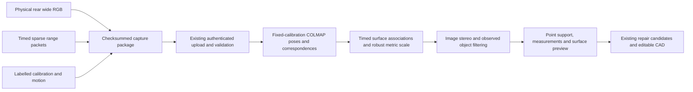

# ReverseCAD: one-camera sparse-range reconstruction specification

Implementation snapshot: 2026-10-18. This document specifies the measurement and initial 3D reconstruction stage implemented locally on `codex/sparse-reconstruction`, starting from main revision `754c0661f97d4b4c1e74ca2cb60519113c1d6c54`.

**Publication scope:** this commit publishes the specification to `pranav-dev`. It does not publish or merge the implementation. Source paths below describe the implementation worktree and may not exist on this branch until that code is integrated. The existing dirty checkout and the Prelude source/recording directories have been preserved.

**Current acceptance state:** the implementation builds, passes its new backend and Swift checks, and runs through the existing reconstruction, candidate and CAD boundaries on a synthetic multi-view fixture. A fresh moving-camera phone scan is still pending. The phone is now connected and its owner has confirmed that Prelude is stopped and available. A signed Debug build is prepared; installation and a successful device scan have not yet been demonstrated. Neither physical dimensional accuracy nor printed fit is established.

## 1. Owned scope and user workflow

This stage owns acquisition, immutable capture packaging, observed-object geometry, metric scale, inspection artifacts and the handoff to existing repair reasoning. It uses one physical rear wide/1× camera and the intercepted computed `BackSparseTimeOfFlight` range/XYZ stream while the phone moves around a stationary object.

The intended workflow is:

1. Aim at a stationary, matte/textured object inside the capture guide.
2. Tap Start and move sideways slowly through overlapping viewpoints.
3. Review the reconstructed observed shape and confirm that it represents the intended object.
4. Continue into the existing evidence/reference-photo, repair-candidate, parameter-edit and export workflow.

Ordinary scanning requires no ruler, printed board, manual object dimensions, three-camera calibration or TrueDepth calibration. Existing CAD safety and critical-dimension requirements still apply to a proposed repair: absent mounting dimensions remain questions, rather than being invented by the scanner.

Observed geometry and inferred repair geometry remain distinct. Reference photos may inform missing-part shape but do not establish unseen metric dimensions. A preview mesh, valid CAD solid or exported STL is not proof of fit.

## 2. Architecture and source inventory



| Implementation location | Responsibility |
| --- | --- |
| `research/sparse-capture/SparseCapture.m`, `.h`, `Bridging.h` | Debug-only runtime hooks; packet originals, identity evidence, calibration and source diagnostics |
| `ios/ReverseCAD/CaptureARKit.swift` | Research capture mode, exact image originals, selected RGB frames, motion, guidance and package completion |
| `packages/ReverseCADCore/.../Capture.swift`, `Persistence.swift` | Backward-compatible metadata, asset inventory, checkpoint/recovery/import/export validation |
| `backend/reversecad/sparse/decoder.py` | Lossless reused native packet decoder |
| `backend/reversecad/sparse/capture.py` | Extension validation, explicit slot validity, transforms and timing report |
| `backend/reversecad/sparse/sfm.py` | Fixed recorded intrinsics, real-image pose recovery and object-supported triangulation |
| `backend/reversecad/sparse/registration.py` | Time interpolation, surface association, echo ambiguity and robust global scale |
| `backend/reversecad/sparse/stereo.py` | Reused and bounded CPU rectified stereo adapter |
| `backend/reversecad/sparse/pipeline.py` | Metric observed object, per-point provenance, fits, measurements, preview and existing result contract |
| `backend/reversecad/sparse/import_prelude.py` | Read-only historical recording import, including separately labelled processed-depth baseline inputs |
| `backend/reversecad/reconstruction.py`, `service.py`, `workers.py` | Existing reconstruction dispatch, package/capability validation and downstream consumption |
| `ios/ReverseCAD/AppModel.swift`, `UnifiedRepairView.swift` | Reconstruction report loading, actual geometry review and continuation to existing repair UI |
| `scripts/sparse_reconstruct.py` | Saved-input import, reconstruction and same-input baseline comparison |
| `scripts/generate_sparse_fixture.py`, `evaluate_sparse_fixture.py` | Explicitly synthetic integration fixture and separate oracle evaluation |

The existing `reconstruct(scan_dir, output_dir, annotations)` boundary is preserved. For the normal `rgb_assisted` reconstruction stage, an explicit sparse extension dispatches to the new pipeline before automatic cube/planar routing. Packages without that extension retain their previous behavior. The explicit `raw_depth_pose` stage remains available for a separately labelled baseline.

## 3. Capture source and isolation

### Debug boundary

`ReverseCADSparseResearch` is a separate scheme/target. Private interception sources are absent from the ordinary app target. Compilation requires both `DEBUG` and `SPARSE_RESEARCH`; a build guard rejects non-Debug and archive/install build actions. This target is for local device research, not Release, TestFlight or distribution.

Runtime hooks check the observed method type encodings before installation and forward original callback arguments unchanged. Missing or changed classes/signatures produce unavailable diagnostics. Normal prototype acquisition does not replace RGB with black images. Historical black-input controls remain in the untouched Prelude experiment.

### Physical 1× identity

The selected AR format requests the physical built-in rear wide camera at 30 fps, choosing the available format closest to 1280×720. This resolution is a preference, not an assumed fact: actual dimensions and calibration are stored.

Identity evidence links source-port/device metadata to the ARFrame using source timestamp, dimensions and hashes of both original active NV12 planes. The camera must be `AVCaptureDeviceTypeBuiltInWideAngleCamera`, position `back`, have a nonempty device ID and be explicitly verified. No numeric channel-order assumption identifies a camera. All selected reconstruction frames must have the same physical camera ID.

### Originals and metadata

For selected frames, the package retains tightly packed active rows of both original NV12 planes and a full-size JPEG produced by declared CoreImage color conversion at quality 0.97. Padding is excluded consistently from plane files and identity hashes. Images are not silently cropped, rotated or resized before storage.

Recorded information includes original dimensions, pixel format, source/arrival timestamps, per-frame camera intrinsics, orientation/image transforms, source identity, focus/exposure/zoom/crop/stabilization information when available, and the supporting hook evidence. Device state read back at callback time is labelled separately from sample attachments; unavailable metadata stays unavailable.

Sparse data is stored as original packet bytes plus an event journal containing byte offsets/lengths, packet sequence, source PTS, callback host time, source metadata and SHA-256. Decoding is off the acquisition callback path. The package also retains available camera-to-sparse calibration and raw calibration bytes/hash.

Raw accelerometer and gyro samples are requested at 60 Hz; fused CoreMotion estimates at 30 Hz. They retain source labels, timestamps and axes. ARKit poses remain separately labelled estimates. Neither motion stream nor ARKit pose is independent ground truth; the implemented reconstruction estimates motion from real images without using those poses as priors.

### Bounds, recovery and guidance

Research scans automatically finish at 18 seconds or 48 stored views. View selection is spaced by at least 0.35 seconds and does not require an ARKit pose change. Sharpness and physical identity gate usable RGB frames. Capture guidance includes move sideways, slow down, show another side, improve lighting and keep the object still; it uses the available blur/tracking/source/coverage diagnostics. Direction count is not a complete-coverage claim.

Resource limits are a 16-slot sensor-write queue, 96-entry image identity ring, 32 MiB raw packet cap, 1 MiB acquisition packet cap, 8-slot motion queue, 12,000 raw motion rows, 3,000 fused motion rows and an enclosing 512 MiB package budget. Drops and gaps are recorded. Finish drains pending acquisition work before final checksums. Checkpoints preserve interrupted originals; an incomplete capture is not promoted to successful measurement evidence.

## 4. Capture contract

The outer capture schema remains version 1. A typed optional `sparse_capture` extension is added to the manifest; an optional `sensor_observation` object is added to each frame. Existing RGB/depth assets keep their meanings. Sparse bytes are never disguised as processed depth images.

```json
{
  "sparse_capture": {
    "schema_version": 1,
    "mode": "sparse_range_rgb",
    "status": "available",
    "packet_path": "sparse/origin-packets.bin",
    "event_path": "sparse/origin-events.jsonl",
    "calibration_path": "sparse/calibration.json",
    "clock": "host_monotonic_seconds",
    "RGB_control": "unaltered"
  }
}
```

Status is `capturing`, `available` or `unavailable`. `available` means packets were observed; it does not certify valid returns, successful reconstruction or accuracy. Missing packets/calibration cause an explicit insufficient-data result, not a hidden processed-depth fallback.

Per-frame `sensor_observation` contains the absolute monotonic `source_timestamp_s`, nullable `arrival_timestamp_s`, `clock`, verified `physical_camera`, pixel hashes, optional `original_plane_paths`, and diagnostic metadata. The existing frame `timestamp_s` remains capture-relative. Historical files with no arrival observation use null, not a fabricated timestamp.

`checksums.json` covers capture assets except itself, including sparse originals, journals, calibration, motion and image planes. Package writer/import/recovery/export and server validation include the new asset paths. Raw image plane count, byte sizes and hashes receive additional validation. Nonfinite metadata is converted to null before serialization; original binary data remains unchanged.

Server validation rejects unsupported versions, invalid status/source/calibration conventions, unsafe/escaping paths, stream/journal size violations, non-contiguous packet byte intervals, packet hash mismatch, repeated packet IDs, non-increasing source times, incorrect source port, unindexed trailing bytes, invalid raw plane sizes/hashes and unknown RGB clock relations. Dropped callbacks can remain in the journal without pretending that bytes were saved.

### Slot validity and clock semantics

Every packet slot and echo candidate is retained in derived records. Geometry validity requires finite XYZ/range, positive range/XYZ norm, XYZ norm agreement with reported Euclidean range within `max(0.01 mm, range × 1e-5)`, and finite positive confidence. Unknown flags and other fields remain intact. These are analysis checks, not an assertion that every hardware flag is understood.

Packet PTS is used for its own slots. Individual within-packet exposure offsets are unknown and explicitly reported. Bank addresses are never accumulated into a fictitious simultaneous frame or carried forward through gaps.

## 5. Coordinates, calibration and units

`T_sparse_camera` is the stored 4×4 column-major transform with explicit direction `camera_cv_to_sparse` and translation units **mm**. Its camera type must be the physical wide camera. Raw native affine data and its hash are retained; padded SIMD lanes are normalized into a homogeneous matrix and rigid-transform checks apply.

For a column-vector sparse point, the implemented inverse is:

```text
P_camera_m = transpose(R_sparse_camera) × (P_sparse_mm - t_sparse_camera_mm) / 1000
```

The decoded coordinate origin is not independently established as the physical light-emitter location. Euclidean range is radial in that native coordinate system. Camera-axis Z is calculated after transformation and is not substituted for radial range.

COLMAP uses each recorded pinhole calibration without fitting focal length, principal point or distortion. The adapter converts CV pixel-center convention to COLMAP with `cx + 0.5`, `cy + 0.5`; the inverse adapter restores CV convention. Calibration dimensions must match the preserved RGB dimensions.

The final object frame is the **first registered camera CV frame**, right-handed, x right, y down, z forward. It is not an estimated canonical object orientation. Metric point assets are in **m**; result measurements, preview vertices and CAD dimensions are in **mm**. `T_object_camera_cv` maps a camera-local metric point into this object frame.

## 6. Reconstruction algorithm and actual thresholds

### A. Real-image motion and triangulation

- Keep sharp (`blur_score >= 7`), identity-verified rear wide frames; deterministically subsample at most 48 views. Require at least three.
- Copy original RGB files into the reconstruction workspace. Use recorded per-frame PINHOLE calibration; share cameras only when dimensions and calibration match.
- Run CPU SIFT/exhaustive guided matching with at most 4,096 features/matches and internal feature image width bounded by 1,600 pixels. Preserve original-coordinate correspondences and record working transforms.
- Run one COLMAP model with seed 17, one worker thread, at least 40 initialization inliers, 2° initial triangulation and 1.5° filtering angles. Mapper runtime limit is 90 seconds. Do not use ARKit position priors or refine intrinsic parameters.
- Require at least three registered views and finite mean image reprojection error no greater than 2.5 pixels.
- Object selection intersects the capture guide and any supplied foreground mask, eroded with a 5×5 kernel. Image tracking may use the full scene, but retained object points need at least three inside-mask observations, outside observations no more than 25% of inside observations and point reprojection error at most 2.5 pixels. Require at least 30 retained object points.

### B. Time-resolved sparse association

- Interpolate camera translation linearly and rotation with Slerp between registered image poses. No extrapolation is allowed; brackets longer than 0.55 seconds are rejected. An exact registered timestamp can use its pose directly.
- Transform each valid echo's XYZ into the camera frame and require positive camera Z and an interior object-mask projection.
- Project triangulated image geometry into the interpolated camera. Within a 25-pixel neighborhood require at least six points whose 2D convex hull surrounds the sparse projection.
- Fit a local plane; reject slivers, ambiguous depth edges and poor planarity. The second singular value must be at least 3% of the first; local Z span at most 18% of median depth; median plane residual at most 0.8% of median depth.
- Reject grazing associations with absolute normal/range-direction dot product below 0.3. Retain each plausible echo as its own candidate, with packet, address, time, frames, plane and range provenance.

For a plane `n · X = d` in unscaled SfM camera coordinates and measured metric camera point `p`, each candidate proposes scale `s = (n · p) / d`. The stored transformed native origin is retained when evaluating radial residuals. Quality score affects weighting only after geometric selection; neither highest confidence nor nearest return is a universal echo rule.

### C. Global scale and ambiguity

Fit **one positive global scale**, holding intrinsics, image poses, extrinsics and range bias fixed. Approximately the final quarter of distinct candidate times is withheld from fitting. Consensus evaluates quantile scale hypotheses with a 6% logarithmic scale neighborhood, counting each packet/bank/spot group once.

Competing models more than 15% apart with at least 80% of leading support (and the minimum support) cause abstention. A group with multiple surviving echoes is excluded rather than counted twice. Five Huber reweighting iterations refine scale using a 2% relative scale transition and bounded confidence/timing/local-plane weights.

Require at least 12 training constraints, four distinct bank/spot addresses and three supporting views. Require at least four held-out selected constraints and at least 40% coverage of held-out candidate groups. Report training and held-out radial residuals separately; there is no independent absolute-accuracy bound derived from these checks.

Recovered camera-center bounding-box diagonal after scaling must be at least 10 mm. The current output key is `camera_baseline_m`; its definition is this diagonal, **not** the maximum distance of a particular camera pair.

### D. Additional observed geometry

The dense adapter reuses the existing classical CPU stereo implementation. It uses rectified SGBM, at most 16 pairs, derived image width at most 640 pixels and output stride 2. Rectification uses `alpha=1` to retain field of view; disparity search extends up to half the derived image width, capped at 384. Unsupported vertical rectified baselines are skipped with a recorded reason.

Left/right consistency is bounded by 1 pixel. Cross-view consistency requires at least three distinct supporting views and relative Z disagreement at most 2%. Additional filters require projection inside the object in at least three views, outside count no greater than `max(1, 0.15 × inside count)`, and proximity to retained triangulation. The latter threshold is three times median nearest-neighbor triangulation spacing, clamped to 3–10 mm. Points are rejected, never snapped onto a fitted surface.

Metric triangulation, accepted stereo and selected direct sparse XYZ observations are combined with distinct source classes. A 0.7 mm voxel selects existing rows without averaging away provenance. Optional annotation bounds crop in object-frame meters. Fewer than 30 retained points or any observed extent over 1.5 m causes insufficient-data status. These are prototype gates, not universal object-size support.

### E. Fits and preview

The pipeline reuses existing plane/cylinder/contact feature fitting on the observed metric points. It labels those measurements `multiview`, links sparse scale and point-support artifacts, and reports observed axis extents. An observed extent is not necessarily a full-object dimension; unseen regions remain unknown.

Correlated point-subset fit variation is renamed `support_subset_variation_mm`, with `repeatability_mm` left null. It is not independent temporal repeatability.

The preview uses local ball-pivot triangulation. Radius derives from twice median nearest-neighbor spacing, clamped to 0.5–8 mm, with a second radius twice as large. Triangle edges must not exceed the smaller of 15 mm and four times radius; all three vertices must share at least two supporting views. No hole filling, Poisson closure, smoothing or generative depth completion supplies engineering evidence. A point-only result is allowed when triangles are unsupported.

## 7. Outputs and downstream contract

| Artifact | Meaning and units |
| --- | --- |
| `reconstruction.json` | Existing result envelope plus `source=sparse_range_rgb`, `algorithm_version=sparse-rgb-1`, bounds, primitives, measurements, warnings, coverage/support and explicit uncertainty |
| `points_measurement.npz` | Authoritative observed points in m, RGB colors, observation IDs and source classes; consumed by existing fit/collision/CAD paths |
| `observed_points_m.ply` | Inspectable colored observed cloud in m |
| `observed_surface_m.ply` | Optional locally supported display mesh in m |
| `scan_preview.json` | Existing renderer-compatible vertices in mm, triangles and colors |
| `point_support.json` | Per-output-row observation IDs, source classes and supporting frame IDs |
| `direct_range_points.npz` | Selected directly measured sparse points and observation IDs, retained separately even if combined voxel selection omits some rows |
| `camera_poses.json` | Metric camera poses in the declared object frame, timestamps, calibration and source |
| `decoded_sparse.jsonl` | All original slots/echoes as derived records, original fields, hashes, times, validity and reasons |
| `sparse_associations.json` | Candidate geometric associations and rejection counts |
| `selected_sparse_support.json` | Selected metric constraints, global scale and train/held-out diagnostics |
| `sfm/` | Database, image copies, model, camera inputs, method report and stereo working-transform evidence |

`observations.accepted_frames` and unregistered frame IDs preserve the existing candidate engine's observation interface. Measurement support and metric constraints are linked rather than reduced to a single confidence number. `absolute_accuracy_mm` and uncalibrated uncertainty components remain null; `coverage_is_complete` is false; `physical_fit` is `not_tested`.

The authenticated service retains scan creation/upload/commit, reconstruction jobs and artifact download. `/v1/capabilities` advertises the sparse research mode and separate `raw_depth_pose` baseline. The existing worker publishes the actual result artifacts. Downstream proposals use the measured point asset for collision/fit checks and preserve unresolved critical dimensions.

The iOS review loads the actual `scan_preview.json`, displays source/support limitations in diagnostics and requires confirmation that the preview shows the intended object and relevant surfaces before Continue to repair. It enters the existing project view instead of a disconnected viewer. The research mode does not request the previous processed-depth live repair ghost.

## 8. Evidence obtained so far

### Untouched real packet fixture

Historical source: `2026-10-18T09-43-59Z_arRulerBlack_B3C530` under Prelude's local research recordings. Original `origin-packets.bin` SHA-256:

```text
3ffa40811f65fa2037a37e76b1dae773461b726a6ca1689831bbf430862875f2
```

All 118 packets round-trip byte-for-byte through the decoder, with 84 slots each and 9,912 total slots. There are 2,210 slots passing the declared analysis validity checks and 112 bank/spot addresses. Positive-range echo counts are 2,074 for echo 0, 179 for echo 1 and zero for echo 2; positive range alone is not full validity. Maximum recorded packet gap is approximately 49.966 ms.

The imported historical recording contains nine real wide-camera frames plus retained original processed-depth/confidence planes and separately labelled limited-tracking black-input AR poses. The new method correctly returns insufficient data because it cannot recover a translated multi-view model. The same-input baseline also produces no accepted geometry from its limited-tracking poses. This stationary diagnostic fixture does not establish moving-object-scan feasibility or a fair accuracy/runtime win.

### Synthetic same-input algorithm comparison

An explicit synthetic 100×60×40 mm textured block supplies 24 rendered views and synthetic sparse packets. Ground-truth evaluation is outside the capture package and is not provided to reconstruction. Comparison uses the same saved input package; the baseline receives its exact rendered depth/poses, while the new method recovers image motion and sparse metric scale. This favors the idealized baseline and does not predict physical ARKit performance.

| Measurement | New image + sparse method | Existing processed-depth baseline |
| --- | ---: | ---: |
| Output observed points | 41,388 | 73,908 |
| Preview triangles | 8,856 | 0 |
| Runtime in recorded local run | 8.737 s | 0.781 s |
| Extents in oracle frame, mm | 104.397 × 60.868 × 45.294 | 100.00003 × 59.99419 × 40.00003 |
| Signed extent errors, mm | +4.397, +0.868, +5.294 | +0.00003, −0.00581, +0.00003 |
| Median absolute distance to oracle surface | 0.556 mm | approximately 0.000005 mm |
| 95th percentile absolute surface distance | 1.734 mm | approximately 0.000012 mm |
| Dimension gate: max(0.5 mm, 1% of dimension) | **Fail** | Pass |

The new run registers 22/24 views, retains 715 SfM points before later filtering and reports mean image reprojection error 0.644 pixels. Metric scale is 0.0595182 m per SfM unit, supported by 38 selected constraints from 14 addresses: 29 training and nine held out. Median absolute radial residual is 1.010 mm in training and 0.545 mm held out; held-out 90th percentile is 1.525 mm. These internal residuals do not override the failed independent extent check.

After filtering/voxel selection, output source classes are 40,940 image-stereo rows, 434 triangulated rows and 14 direct sparse rows. All 38 selected direct constraints remain separately inspectable. Two single-thread runs produced exactly equal point/color/ID/source arrays on this machine. No cross-platform determinism or independent physical repeatability is claimed.

### Automated and build verification

- Latest selected backend regression run: **183 passed, two failed**. The two failures are existing cube photo API tests (`test_cube_routes_require_pairing_and_report_scope` and `test_automatic_api_accepts_photo_without_corners`) that expect 200 but receive insufficient-evidence 422 responses. Both reproduce against an untouched archive of the starting main revision using the same environment; they are not presented as passing.
- All ten new sparse tests pass within that run: original bytes/invalid echoes, radial versus Z, transform direction/units, stale timing, robust echo selection, competing-model abstention, object masks, schema/backward compatibility, package corruption and actual service-to-CAD integration.
- Swift core suite: **18 passed**, including original image/sparse asset commit, recovery/import round trip and missing/corrupt/nonfinite metadata rejection.
- Signed research Debug build and code-signature verification pass. Ordinary Release build passes. Research Release fails at its required guard.
- Three private-hook marker checks are present in research Debug binaries and absent from the ordinary Release executable. Archive rejection is configured; no distribution archive was produced.

The integration test reconstructs the synthetic fixture through real service workers, downloads the actual preview, selects an actual fitted plane for a repair contact and invokes the existing bracket candidate path. Missing mounting dimensions remain questions. A separately confirmed **test-only** 4 mm hole dimension and explicit uncertainty acknowledgement permit a manual CAD prototype; STEP/STL/3MF downloads are hash-verified and the fit check consumes more than 100 actual observed points. This verifies the handoff, not automatic completion of all missing geometry or real printed fit.

## 9. Remaining validation and limitations

The next acceptance run must use a fresh moving-camera capture of a stationary matte/textured object. Verify original physical 1× identity evidence and genuine sparse packets on the current OS, usable calibration, recovered translation and overlapping image geometry, selected timed metric support, an object-dominated preview, and continuation through the existing repair flow. Independent known dimensions should then be evaluated separately from image-fit residuals and internal range consistency.

The current phone is connected and the owner has released the stopped Prelude session for use. The available local development profile uses Prelude's app identity, so deployment replaces/restarts that app after its data is preserved. The independent capture/install/scan acceptance steps were paused to publish this specification first.

Known limits include unverified live hook availability on this OS build, unknown within-packet exposure timing, factory-calibration uncertainty, unverified physical emitter origin, no fitted range bias/time offset/distortion, fixed-scale rather than jointly optimized sensor bundle adjustment, texture/overlap dependence, conservative local-plane association, foreground-mask errors and remaining possible background contamination. Some views may have only the capture guide; the required visual review is material. The synthetic extent failure already prevents any claim of validated engineering accuracy.

Historical sparse ruler separation error (+1.21 mm median signed), camera-axis disagreement (+6.70 mm), later camera-derived ruler-plane disagreement (+9.713 mm median), and selected static-range temporal MAD (about 0.34–0.57 mm) describe different experiments/quantities. They are not collapsed into one accuracy specification. The camera-derived reference also has uncertainty.

The intercepted stream contains computed range candidates, calibrated XYZ, bank/spot/echo IDs, quality, intensity/SNR and flags. It is observed before particular app-side wrappers and responds to physical scene motion. Raw photon histograms have not been recovered and independence from upstream Apple processing is not established. Black imagery at an observed hook does not prove all upstream RGB influence is absent.

Printed fit remains **untested**. Fresh physical dimensional accuracy remains **unvalidated**. Hidden/unobserved surfaces remain **unknown**.

## 10. Reproduction after implementation integration

Use the implementation worktree or a future branch containing its source files. Outputs below must be fresh paths; the importer never modifies its historical source directory.

```sh
uv sync --frozen
PYTHONPATH=backend .venv/bin/python scripts/sparse_reconstruct.py import-prelude \
  /path/to/2026-10-18T09-43-59Z_arRulerBlack_B3C530 work/ruler-import
PYTHONPATH=backend .venv/bin/python scripts/sparse_reconstruct.py run \
  work/ruler-import work/ruler-result --compare

PYTHONPATH=backend .venv/bin/python scripts/generate_sparse_fixture.py work/example-synthetic
PYTHONPATH=backend .venv/bin/python scripts/sparse_reconstruct.py run \
  work/example-synthetic work/example-result --compare
PYTHONPATH=backend .venv/bin/python scripts/evaluate_sparse_fixture.py \
  work/example-synthetic work/example-result work/example-evaluation.json

PYTHONPATH=backend .venv/bin/python -m pytest -q backend/tests/test_sparse_reconstruction.py
swift test --package-path packages/ReverseCADCore

PYTHONPATH=backend .venv/bin/python scripts/serve.py --lan --port 8769 \
  --data-dir work/sparse-service
```

The service creates a private pairing token under its data directory. Configure the app with the reachable Mac service URL and that token; do not publish the token. Reconstruction and deterministic candidate paths do not need a live vision-model key.

Generate/build the `ReverseCADSparseResearch` Debug scheme using a valid local development identity/profile. Coordinate with the device owner and preserve the existing app data before any same-identity install. The prepared prototype uses the established local signing arrangement; no profile secret or pairing credential is included here.

For implementation provenance, the lossless decoder was selectively reused from the existing sparse-native-byte-forensics lab, the stereo adapter from the existing metrology COLMAP adapter, and interception/identity patterns from Prelude's `OriginProbe.m`, `InputGate.m` and `RealImageRecorder.m`. Source hashes and selection notes are stored with the implementation in `docs/sparse-reconstruction/reuse.json`; original source hashes were rechecked unchanged. Detailed capture/reconstruction notes and measured artifacts remain in that worktree's `docs/sparse-reconstruction/` and `reports/sparse-reconstruction/` directories.
