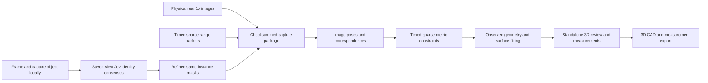

# ReverseCAD: standalone object scanning and measured 3D export

Scope revision: 2026-10-18. Branch: `pranav-dev`.

## 1. Product boundary

Pranav's component is a standalone **frame → scan → identify → build → preview/export** workflow. The user scans an existing physical object and receives an inspectable, metrically scaled 3D representation of what was observed.

This component does not propose a repair, invent a missing part, generate a replacement, or enter the main application's repair workflow. Integration into `main` is deferred. Work belongs on `pranav-dev` or an isolated feature branch until separately requested.

The delivery is the scanned object: a colored point cloud, supported surface model, inspectable dimensions, and downloadable 3D/CAD files. No ruler, printed calibration board, manual object dimensions, three-camera rig or TrueDepth calibration is a normal scanning prerequisite.

**Capture-first revision (2026-10-18):** The public TestFlight workflow is specified in [PRELUDE_SCANNER.md](PRELUDE_SCANNER.md). It supersedes the previous live-Jev flow. Capture and identification require no Mac. Reconstruction still requires the existing backend; the app states this before processing. Private intercepted sparse capture remains separate and Debug-only.

## 2. Capture and identify

Open the public camera with a guide covering the center third of preview width and height, mapped using the actual display transform. Say “Place one object inside the box.” Description is optional. Start one session with “Keep the object still. Walk slowly around it, keeping it inside the box.” Save full images, available depth/confidence, intrinsics, poses and timestamps locally. The guide is never a destructive crop. Show guidance from actual motion and accepted views. Finish without a compulsory second orbit.

After Finish, show “Finding your object…” and choose roughly 8–10 sharp separated saved views. Preserve the initial centered usable view as reference. Direct Jev calls compare that physical instance with every selected view. Ask category, same-instance presence, ambiguity, box and hand obstruction. Use multi-view consensus; if ambiguous, show a saved image for one tap. Retry or cancellation preserves the session.

## 3. Selection, reconstruction and export

The phone refines boxes through local Vision masks and short-range tracking. Store derived masks separately with original-image hashes. The matching backend excludes unconfirmed views, checks measured cross-view consistency and removes supported surrounding horizontal planes. Full images are retained for camera tracking. Jev selects the object; observed geometry and supported scale determine its dimensions. The app explicitly discloses Mac reconstruction before Build. Use the original capture with these derived masks; do not scan again merely because identification occurred later.

Reuse observed preview/export. Preserve actual holes and missing surfaces. Export STL/PLY and measurements; offer STEP when the existing faceted-surface exporter passes its limits. Never replace missing geometry with a category template. Preserve insufficient captures and describe additional views needed. Keep keys in the existing ignored personal-build configuration, out of exports and logs.

Provider contract: [TypeSafe API](https://docs.typesafe.ai/api), [images](https://docs.typesafe.ai/images), [Box](https://docs.typesafe.ai/primitives/box). The actual two-image request is `JevClient.identifySavedView`, bounded to ten sequential calls per attempt. See the normative scanner document for timeouts, consensus and retry rules.

## 4. Module architecture



Reuse the existing local camera, package validation, classical geometry and renderer code where useful. Keep the scanner's public inputs/outputs independent of repair families, contacts for a replacement, candidate IDs and CAD generation requests for a missing part. Internal code reuse does not authorize a product handoff to the main repair pipeline.

The useful reconstruction boundary remains `reconstruct(scan_dir, output_dir, annotations)`. Scanner annotations are target selection, crop, additional confirmed observations and measurement requests. A standalone service/UI adapter consumes the reconstruction result and exposes scan exports. Existing `raw_depth_pose` remains a separately labelled development baseline; it must not masquerade as the sparse prototype.

## 5. Implemented capture core to retain

### Source identity and originals

Use the physical built-in rear wide/1× camera. The current target requests 30 fps and selects the available format closest to 1280×720; save actual dimensions rather than assuming that preference is guaranteed.

Camera identity is verified from source-port/device metadata plus matching source PTS, image dimensions and hashes of both active NV12 planes at the ARFrame boundary. Require `AVCaptureDeviceTypeBuiltInWideAngleCamera`, back position and a nonempty, stable device ID. Numeric channel ordering is not camera identity.

Retain tightly packed active NV12 planes and full-size RGB JPEG keyframes. The current JPEG uses declared CoreImage conversion at quality 0.97, without app crop/rotation/resizing. Save per-frame intrinsics, source/arrival times, orientation and working transforms, exposure/focus/zoom/crop/stabilization metadata when available, with callback-time readback distinguished from per-sample attachments.

Preserve original sparse packet bytes, event offsets/lengths, sequence, source PTS, callback host time, SHA-256, source identity and available calibration. Preserve all echoes and unknown fields in derived decoding. Record gaps and drops rather than filling them with stale data.

Raw accelerometer/gyro at a requested 60 Hz and fused CoreMotion at 30 Hz remain labelled diagnostics. Public ARKit poses are labelled estimates; the implemented reconstruction recovers poses from real images without using ARKit positions as priors.

### Research isolation and budgets

Private hooks remain exclusive to `ReverseCADSparseResearch`, with both `DEBUG` and `SPARSE_RESEARCH` compile guards. Reject non-Debug and archive/install build actions. The ordinary app target has no private interception source. This is a local research prototype, not a TestFlight/distribution target.

Hooks check observed runtime signatures and forward original callback arguments unchanged. The normal scan path does not black out RGB. Historical black-input experiments remain separate diagnostic controls.

Current bounds: 16 sensor-write slots, 96 image-identity entries, 32 MiB raw packet stream, 1 MiB acquisition packet, eight queued motion writes, 12,000 raw motion rows, 3,000 fused rows and 512 MiB enclosing scan package. Finish drains writes before checksums. Interrupted originals remain recoverable and explicitly incomplete.

## 6. Backward-compatible data contract

The outer capture schema stays version 1. Sparse observations use a separate optional versioned extension:

```json
{
  "sparse_capture": {
    "schema_version": 1,
    "mode": "sparse_range_rgb",
    "status": "available",
    "packet_path": "sparse/origin-packets.bin",
    "event_path": "sparse/origin-events.jsonl",
    "calibration_path": "sparse/calibration.json",
    "clock": "host_monotonic_seconds",
    "RGB_control": "unaltered"
  }
}
```

Status is `capturing`, `available` or `unavailable`. Available means packets were observed, not that accuracy or reconstruction passed. Per-frame `sensor_observation` holds absolute monotonic source time, nullable arrival time, camera identity, pixel hashes and original-plane paths. Existing `timestamp_s` remains capture-relative. Sparse packets are not stored as ordinary ARKit depth images.

Add a separately versioned **object-selection** record for the description, user-confirmed target, frame-linked Jev detections, masks and tracking states. The public capture-first implementation stores this record separately from original observations. It must reference immutable source frames and explicit image transforms; it does not alter original pixel or packet bytes.

Checksums cover all assets except the checksum manifest itself. Validate versions, paths, size bounds, contiguous indexed packet intervals, per-packet hashes, source ports, unique sequences, strictly increasing source timestamps, clock relation and image-plane hashes/sizes. Reject trailing unindexed packet bytes. Serialize nonfinite metadata as null; binary originals remain unchanged.

Slot geometry validity currently requires finite positive range/XYZ norm, positive finite confidence and agreement of XYZ norm with radial range within `max(0.01 mm, range × 1e-5)`. Unknown flag bits are preserved. All 84 typical slots and all three echo candidates remain inspectable even when excluded from geometry.

## 7. Frames, units and timing

`T_sparse_camera` is column-major, direction `camera_cv_to_sparse`, with translation in **mm**. Raw affine calibration bytes/hash remain alongside the normalized homogeneous matrix. For column vectors:

```text
P_camera_m = transpose(R_sparse_camera) × (P_sparse_mm - t_sparse_camera_mm) / 1000
```

This decoded origin is not an independently verified physical emitter location. Euclidean range is radial in the native frame; camera-axis Z is calculated separately. Recorded pinhole calibration is fixed. CV-to-COLMAP pixel-center conversion adds 0.5 to principal-point coordinates and is reversed on return.

The current output frame is the first registered camera's right-handed CV frame: x right, y down, z forward. Point clouds and camera transforms use **m**; preview vertices, displayed dimensions and CAD exports use **mm**. A later convenient display orientation must be an explicit saved rigid transform, never an undocumented geometry/scale change.

Each packet uses its own PTS. Within-packet spot exposure offsets are unknown. Interpolate only between registered image poses with brackets at most 0.55 seconds; no extrapolation or stale bank accumulation. ARKit motion and camera timestamps are not independent ground truth.

## 8. Implemented reconstruction core

### Image geometry

Use at least three sharp, verified same-camera frames (`blur_score >= 7`), at most 48 views. Reuse CPU COLMAP SIFT/exhaustive guided matching with fixed recorded PINHOLE intrinsics, at most 4,096 features/matches, internal feature width at most 1,600 pixels, seed 17 and one worker thread. Keep original images and record working transformations.

The mapper uses at least 40 initialization inliers, 2° initial and 1.5° filtering triangulation angles, one model and a 90-second mapper budget. Require at least three registered views and mean reprojection error at most 2.5 pixels. Do not refine focal length, principal point, distortion, range bias or timing offset.

Current foreground selection intersects the guide and any available mask, with 5×5 erosion. The revised product must feed the confirmed target masks into this stage. Retain triangulated object points with at least three inside-mask observations, outside observations at most 25% of inside support and point error at most 2.5 pixels. Require at least 30 object points.

### Sparse metric scale

At each packet time, transform every valid echo into the interpolated camera and require a forward, interior object projection. A local 25-pixel neighborhood needs at least six triangulated points whose projected hull surrounds the observation. Reject slivers, large depth edges, poor planarity and grazing incidence.

Current gates: second plane singular value at least 3% of first; local Z spread at most 18% of median depth; median plane residual at most 0.8% of depth; absolute normal/range-direction dot product at least 0.3.

Fit one positive global metric scale. Geometric consensus uses a 6% logarithmic scale neighborhood and counts each packet/bank/spot group once. Competing hypotheses over 15% apart with at least 80% of leading support cause abstention. Multiple surviving echoes for one group are excluded. Five Huber iterations use a 2% relative transition; confidence only weights geometrically supported candidates.

Require at least 12 training constraints, four bank/spot addresses, three supporting views and a final-time held-out block with at least four constraints and 40% candidate-group coverage. Report train/held-out radial residuals separately from absolute accuracy. The current `camera_baseline_m` gate is a scaled camera-center bounding-box diagonal of at least 10 mm, not a particular pairwise baseline.

### Additional surface detail

Reuse rectified CPU SGBM: up to 16 pairs, derived image width at most 640, output stride 2, rectification `alpha=1`, disparity search up to half width capped at 384. Skip unsupported vertical rectified baselines with a reason. Require left/right consistency within 1 pixel and three-view relative Z agreement within 2%.

Require dense points inside the target in at least three views, outside count at most `max(1, 0.15 × inside count)`, and proximity to retained triangulation. The proximity threshold is three times median nearest-neighbor spacing, clamped to 3–10 mm. Reject points rather than snapping them to a fit.

Combine image triangulation, stereo and direct sparse observations with separate provenance. A 0.7 mm voxel selects existing rows rather than averaging. Preserve selected direct constraints separately. Support explicit object-frame cropping; fewer than 30 points or any extent over 1.5 m produces an insufficient-data result.

Local ball-pivot preview triangles require bounded edges and at least two common support views across their vertices. No smoothing, hole filling or generative depth supplies authoritative observed geometry. Open/unseen regions stay unknown.

## 9. Measurements and scanned-object CAD export

### Measurements

Expose observed bounds, point-to-point distances and supported fitted primitives/surfaces. Auto-dimensions must identify their frame and definition. A camera-frame bounding-box extent is not automatically the object's semantic width/height/depth. Object-aligned or fitted box dimensions require sufficient observed surfaces and a recorded fitting method.

Each dimension carries value, unit, supporting point/frame/range IDs, method, coverage and uncertainty status. Unknown absolute uncertainty is null/unknown. Fit residual, image reprojection residual, correlated subset variation and physical repeatability are distinct quantities. A model label such as “box” must never fill in an unseen side's location or a standard product dimension.

### Required exports

| Output | Requirement |
| --- | --- |
| PLY | Colored observed point cloud, declared units and frame |
| OBJ or STL | Supported observed surface; explicit open/incomplete status; no automatic watertight completion |
| STEP | Importable CAD surface/shell of the scanned object, or a supported fitted solid only when the observations justify closure |
| Measurements JSON and CSV | Named dimensions, units, support references, method and uncertainty/coverage status |
| Scan manifest | Source/coordinate/scale provenance, file hashes, export settings and validation results |
| Original capture archive | Original images, packets, calibration and journals available separately for inspection/reprocessing |

Scanned-object STEP export is required new work. It must export the **observed object**, not route through a bracket/handle replacement template. Where appropriate, fit planes/cylinders and preserve their parameters. For arbitrary observed surfaces, a faceted or fitted surface shell is acceptable if labelled accurately; do not call a triangulated shell a fully parametric feature-history model. Partial data may export an open shell. A closed solid requires justified topology and explicit validation.

Validate exported units, finite coordinates, face indices/topology and readback in an independent CAD/mesh reader. Compare exported bounds/dimensions with reconstruction and verify file hashes after transfer. Mesh validity is not physical fit. The existing repair STEP/STL/3MF test does **not** validate this new scanned-object STEP exporter.

## 10. Core evidence and current limits

Untouched real fixture `2026-10-18T09-43-59Z_arRulerBlack_B3C530` has packet SHA-256 `3ffa40811f65fa2037a37e76b1dae773461b726a6ca1689831bbf430862875f2`. All 118 packets round-trip byte-for-byte: 9,912 slots, 2,210 passing analysis validity, 112 bank/spot addresses and maximum gap approximately 49.966 ms. No positive third echo is observed. The nine-frame stationary real-image import yields no translated multi-view model; it is not a completed object scan.

An explicit synthetic 100×60×40 mm textured block supplies 24 views, with the oracle outside reconstruction inputs. The new core registers 22 views and produces 41,388 points and 8,856 preview triangles in 8.737 s. Mean image residual is 0.644 pixels. Scale uses 29 training and nine held-out constraints from 14 addresses; median absolute radial residuals are 1.010 and 0.545 mm respectively.

Independent oracle-frame extents are **104.397×60.868×45.294 mm**, errors **+4.397, +0.868, +5.294 mm**. The max(0.5 mm, 1%) dimensional gate **fails**. Median absolute surface distance is 0.556 mm and the 95th percentile is 1.734 mm; these do not override extent failure. The same-input ideal rendered-depth/pose baseline produces 73,908 points in 0.781 s with essentially exact dimensions; it does not forecast real ARKit accuracy.

Two single-thread runs reproduce point/color/ID/source arrays on this machine. Latest selected backend checks: 183 pass, two existing cube API failures also reproduced against untouched starting main. Ten new sparse tests and 18 Swift core tests pass. Signed research Debug and ordinary Release build checks pass; research Release is rejected, with private markers absent from the ordinary Release binary.

These tests validate portions of the reused core. They do not certify the new object-description/Jev/export flow. The old repair-handoff test is outside this revised component's acceptance criteria.

Fresh physical scanning, object-dominated reconstruction, independent dimensional accuracy and scanned-object CAD readback remain to be demonstrated. No part has been printed and fit-tested. The phone prototype test was stopped for this scope revision.

The sparse stream contains computed range/XYZ and quality fields, not recovered raw photon histograms. Complete independence from upstream Apple processing is unproven. Historical +1.21 mm point-pair, +6.70 mm camera-axis and +9.713 mm camera-derived-plane errors and 0.34–0.57 mm static temporal MAD measure different things and must not be collapsed into one accuracy claim.

## 11. Acceptance for this component

1. Ask what the user will scan and retain the answer.
2. Identify the intended instance in the actual camera view with Jev, present the box/outline and get confirmation or correction.
3. Record real physical 1× images and genuine timed sparse packets while moving around a stationary object.
4. Recover image-supported translation and object geometry with recorded sparse metric support; reject background/other instances and flag target loss.
5. Display the scanned object in a standalone viewer with dimensions, coverage and inspectable source/uncertainty.
6. Export the scanned point cloud, surface, scanned-object STEP and measurement package; reopen and verify geometry, units and dimensions.
7. Compare the new core and baseline on identical real inputs, and check independent known dimensions separately from internal residuals.
8. Keep all work isolated from `main`; no repair proposal or missing-part generation in this product flow.

Until these checks pass, report which stage is incomplete rather than claiming a complete measured CAD scanner.

## 12. Core reproduction and implementation locations

Implemented local core resides in `backend/reversecad/sparse/` (`capture`, `decoder`, `sfm`, `registration`, `stereo`, `pipeline`, `import_prelude`), `research/sparse-capture/`, the research branches of `ios/ReverseCAD/CaptureARKit.swift`, and shared package/schema validation. Existing core result artifacts include `points_measurement.npz`, `observed_points_m.ply`, optional `observed_surface_m.ply`, `scan_preview.json`, `point_support.json`, `direct_range_points.npz`, `camera_poses.json`, `decoded_sparse.jsonl`, `sparse_associations.json` and `selected_sparse_support.json`.

The TypeSafe provider and Box request contract are now identified. The standalone prompt/selection/review/export adapters still need implementation. Do not expose the previous prototype's “Continue to repair” screen as this component's finished UI. Do not publish private capture code through a distribution target.

Core-only reproduction from a worktree containing the implementation:

```sh
uv sync --frozen
PYTHONPATH=backend .venv/bin/python scripts/generate_sparse_fixture.py work/example-synthetic
PYTHONPATH=backend .venv/bin/python scripts/sparse_reconstruct.py run \
  work/example-synthetic work/example-result --compare
PYTHONPATH=backend .venv/bin/python scripts/evaluate_sparse_fixture.py \
  work/example-synthetic work/example-result work/example-evaluation.json
PYTHONPATH=backend .venv/bin/python -m pytest -q backend/tests/test_sparse_reconstruction.py
swift test --package-path packages/ReverseCADCore
```

Use fresh output paths and preserve source recordings. These commands exercise the implemented geometry core, not the pending Jev and scanned-object STEP workflow. No live provider key is required for the core; TypeSafe account credentials and live adapter validation remain implementation setup, not an unresolved provider identity.
