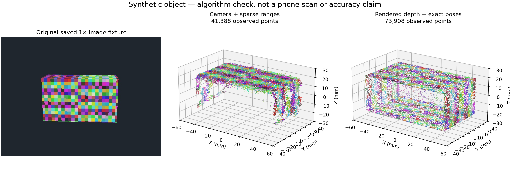

# Measurement and initial 3D reconstruction: measured status

> Scope revised by the owner: the current component is standalone object identification,
> scanning, measurements and scanned-object export. Repair handoff is out of scope.
> See the [current specification](../../docs/SPARSE_RECONSTRUCTION_SPEC.md), published
> to `pranav-dev` as `e5552d1`. The results below describe the earlier core prototype.
> The phone test was stopped before a fresh capture. No implementation was merged to main.

Implementation branch: `codex/sparse-reconstruction`; base: `754c0661f97d4b4c1e74ca2cb60519113c1d6c54`.
The original dirty checkout and Prelude sources/recordings remain untouched.
The [full specification](../../docs/SPARSE_RECONSTRUCTION_SPEC.md) was separately
published to `pranav-dev` in commit `2e76d2ce690a57bc76a5af62d1831233eb9bca0e` at the owner's request.
The implementation itself has not been published or merged.

## What works in software

The Debug research target records physical-wide identity evidence, original NV12
planes/full-size RGB, independent timed sparse bytes, calibration and labelled
motion. Bounded queues, finite metadata and checksummed recovery are implemented.
The existing reconstruction boundary dispatches the versioned extension to
fixed-calibration image SfM, timed robust sparse scale, CPU stereo and local
observed-surface preview. The existing service, review, candidate and CAD paths
consume its actual artifacts. Source classes, uncertainty and unsupported regions
remain explicit. See [reproduction instructions](../../docs/sparse-reconstruction/README.md).

## Recorded bytes and real stationary fixture

The original packet hash is
`3ffa40811f65fa2037a37e76b1dae773461b726a6ca1689831bbf430862875f2`.
All 118 packets round-trip exactly: 9,912 slots, 2,210 passing analysis validity,
112 bank/spot addresses and maximum packet gap 49.966 ms. No positive third echo
is observed. [Byte audit](recorded-byte-audit.json) and
[source preservation](source-preservation.json) retain details.

The historical real-image import retains nine wide-camera views and their
original processed-depth/confidence planes. New reconstruction returns
`needs_input` with zero points because there is no translated multi-view model
(2.151 s). The same-input processed-depth baseline also returns zero points
because the archived black-input AR poses have limited tracking. This is a decoder
fixture, not successful moving-camera acceptance or a fair accuracy benchmark.

## Synthetic comparison, not physical accuracy

The independent analytic object is 100 × 60 × 40 mm. Oracle information is outside
the capture package and is not supplied to reconstruction. Both methods receive
the same saved package, but the old baseline has exact rendered depth and poses.

| Quantity | New method | Processed-depth baseline |
| --- | ---: | ---: |
| Observed points | 41,388 | 73,908 |
| Preview triangles | 8,856 | 0 |
| Runtime | 8.737 s | 0.781 s |
| Oracle-frame extents, mm | 104.397 × 60.868 × 45.294 | 100.00003 × 59.99419 × 40.00003 |
| Signed extent errors, mm | +4.397, +0.868, +5.294 | +0.00003, −0.00581, +0.00003 |
| Median absolute surface distance | 0.556 mm | approximately 0.000005 mm |
| 95th percentile surface distance | 1.734 mm | approximately 0.000012 mm |
| Independent extent gate, max(0.5 mm, 1%) | **Fail** | Pass |

New SfM registers 22/24 views with mean image residual 0.644 pixels. Scale is
0.0595182 m per SfM unit, using 29 training and nine held-out constraints from
14 bank/spot addresses. Median absolute radial residuals are 1.010 mm training
and 0.545 mm held out. Those residuals do not cancel the failed extent check.

Output provenance comprises 40,940 stereo, 434 triangulated and 14 direct-range
rows after voxel selection; all 38 selected direct constraints remain separately
available. Two single-thread runs produce identical point/color/ID/source arrays
on this machine. That is software reproducibility, not physical repeatability.
[Full comparison](final-comparison.json), [reproducibility](reproducibility.json).

## Tests and build checks

- Backend selected regression run: **183 passed, two failed**. Both failed cube
  photo API tests expect 200 and receive an insufficient-evidence 422. The same
  two failures reproduce against an untouched archive of base main in the same
  environment: [current run](final-tests.log), [base run](baseline-regression-failures.log).
- All ten new sparse tests pass, including untouched bytes, coordinate/time
  semantics, ambiguous echoes, package corruption, and service-to-CAD integration.
- Swift core suite: **18 passed**, including sparse/raw-image package recovery
  and invalid-asset rejection: [Swift run](swift-tests.log).
- Signed research Debug build and signature verification pass. Ordinary Release
  builds, research Release is rejected, and private-hook markers are absent from
  the ordinary Release binary: [build verification](build-verification.json).

The CAD integration test consumes a reconstructed plane and observed points.
It preserves questions about hidden mounting dimensions, then uses a separately
confirmed synthetic test dimension and acknowledged manual prototype request to
export hash-verified STEP/STL/3MF. It proves data flow into existing fit/collision
and CAD code, not automatic hidden-dimension recovery or physical fit.

## Device acceptance remaining

The iPhone is connected and the owner confirmed Prelude is stopped and available.
The research app is installed and its launched executable was verified. The full
backup attempt timed out and is not claimed complete. An in-place update retains
the 49 GB of existing recordings in separate directories; the after-inventory
check is pending. Fresh capture, live hook/identity/calibration availability,
object-dominated preview, real sparse metric support and real-capture continuation
through repair are still pending. [Current device status](device-status.json).

No physical dimensional accuracy or printed-part fit is claimed. Principal
limitations are timestamp/footprint/factory-calibration uncertainty, unknown
physical emitter origin, fixed intrinsics, texture/overlap dependence, imperfect
foreground selection, and the demonstrated synthetic extent error. Missing
surfaces stay unknown; no generated depth or filled mesh supplies measurement
evidence.
